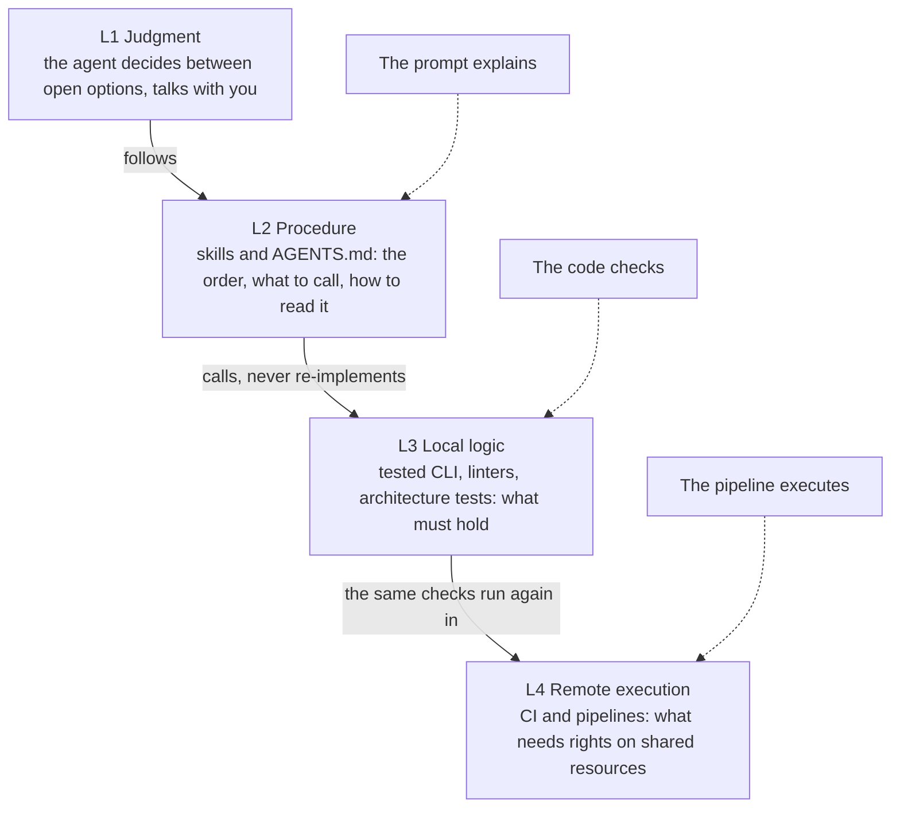
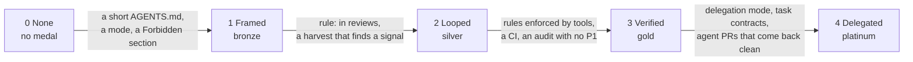
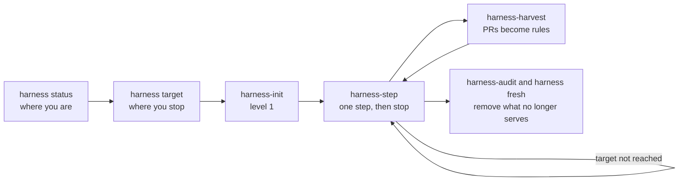
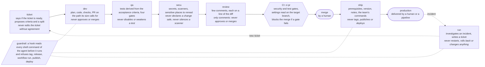

# harness-ai

Claude Code skills and a Python CLI that prepare a repository for AI coding agents, measure where it stands, and move it forward one step at a time.

## The problem

An AI coding agent starts every session knowing nothing about your repository. It does not know the command your CI really runs, the folder that looks dead but is still used, the deployment it must never trigger. So it guesses, and you correct it, again and again.

The usual answer is a long instruction file. It does not hold: past a few dozen lines the agent skims it, nobody prunes it, and a rule written in a prompt is a wish, not a guarantee. An agent that "must not deploy" will deploy the day a ticket asks it to.

A **harness** is everything around the agent that makes its work reliable: a short instruction file (`AGENTS.md`) that says only what the agent cannot discover, rules enforced by tools rather than by sentences, a loop that turns review comments into rules, and pipelines that keep the privileged actions. This repository helps you build one, and tells you where you stand.

The idea fits in one line: **the prompt explains, the code checks, the pipeline executes.** What must be guaranteed is not written in a prompt.

## Try it in two minutes, without Claude Code

You need Python 3.10 or later and git. Nothing to install: the CLI uses the standard library only.

```bash
git clone https://github.com/jrechet/harness-ai.git
```

```bash
python3 harness-ai/cli/harness.py status /path/to/your/repo
```

`status` says which level your repository is at, from 0 (None) to 4 (Delegated), what is already in place, and the next action. It writes `.harness/state.json` in your repository. Then, as you like:

```bash
python3 harness-ai/cli/harness.py commands /path/to/your/repo
```

```bash
python3 harness-ai/cli/harness.py medals /path/to/your/repo --page medals.html
```

`commands` lists the commands your CI runs that an agent would not guess ("`make it`, not `mvn verify`"). `medals` tells the same level as a medal, with the unlocked achievements, and writes a page to open in a browser ([example](docs/examples/medals.html), this repository frozen on 2026-11-16).

## How it works

### Four layers

Every responsibility of a harness has a natural layer. Most reliability problems come from a responsibility placed on the wrong one: a check that lives in a prompt, a deployment an agent can start.

| Layer | Role | Carried by |
|---|---|---|
| **L1 Judgment** | Choose between open options, talk with the human | The agent, its sub-agents |
| **L2 Procedure** | Tell the order, when to call what, how to read a result | Skills, AGENTS.md |
| **L3 Local logic** | Guarantee: preconditions, computations, idempotence | Tested CLI, linters, architecture tests |
| **L4 Remote execution** | Act with rights on shared resources | CI, pipeline |



The test: cut L1 and L2. Do L3 and L4 still serve a human in a hurry? If yes, the agent is an accelerator. If not, some process has leaked into the prompts.

### Five levels, and the right to stop

The harness grows in levels. Each level is earned by checks that `harness status` **measures** in the repository, never by a declaration. A level is reached when all its checks pass and the level below is reached.

| Level | Medal | What it brings | What it asks of the team | How it is measured |
|---|---|---|---|---|
| 0 None | none | Nothing: the agent starts from zero at every session | Nothing | No instruction file |
| 1 Framed | bronze | The agent knows where it is: what the repository does, how far it may go, what it never does | Write a short `AGENTS.md` once, and keep it short | `AGENTS.md` exists · a `Mode:` line · at most 60 lines · `CLAUDE.md` is an `@AGENTS.md` stub or absent · a Forbidden section |
| 2 Looped | silver | Incidents become rules: a mistake corrected in review is not made twice | Mark review comments that should become a rule with `rule:`; collect them from time to time | A Maintenance section · the `rule:` convention documented · a harvest less than 45 days old · the last harvest found at least one real signal |
| 3 Verified | gold | Mandatory rules are held by tools, not by text | Turn each mandatory rule into a check (linter, test, CI job), and say why each rule exists | A CI exists · at least 50% of the rules say "Enforced by" a tool · at least 50% say why · an audit exists with no open P1 |
| 4 Delegated | platinum | Whole tasks come back clean, without correction after the fact | Hand over tasks under a written contract, and watch the agent's PRs | Mode delegation · a Working process section · at least one task contract referenced · agent PRs with no after-the-fact correction in the last harvest · the audit's "cut the agent" test passes |



**A level is a place where you can stay.** You say which one you aim for (`harness target`); beyond it, the tool proposes nothing, and when it is held `status` says "target reached". Many teams are well served by level 1 or 2. Some checks only time can pass, such as a real review signal or clean agent PRs: they do not block work on the next level you aim for.

The level measures the **shape** of the harness: files, sections, mentions. It does not say that the agents work better. Model and thresholds: [docs/maturity.md](docs/maturity.md).

### Step by step

1. **Measure.** `harness status` says where you are; `harness target <level>` says where you want to stop.
2. **Frame.** `harness-init` writes level 1: a short `AGENTS.md` with the commands an agent cannot guess, a mode, and what is forbidden. You can stop here.
3. **Step.** `harness-step` makes one step toward the target level, and only one: the `rule:` feedback loop in reviews, a guardrail per rule, then the working process.
4. **Learn.** `harness-harvest` turns what happened in your PRs into proposed rules.
5. **Prune.** `harness-audit` rereads everything when the model changes or every six months, and proposes to remove what no longer changes what the agent does. In between, `harness fresh` says what has aged.



## What you can do today

Three levels of confidence, always the same words: **tested** (run on a fresh clone, with tests), **measured** (an agent that never saw the answer key played it, and a program graded the result), **written** (the skill exists, nobody has played it end to end yet).

### With the CLI alone

| You want to… | Command | State |
|---|---|---|
| Know where your repository stands | `harness.py status <repo>` | tested |
| Say at which level you stop | `harness.py target <level> <repo>` | tested |
| See each rule, its age, its guardrail | `harness.py rules <repo>` | tested |
| Find the commands an agent does not guess | `harness.py commands <repo>` | tested |
| Know what has aged: a skill that cites a deleted file, a late harvest | `harness.py fresh <repo>` | tested |
| See your level as a medal, with achievements and next steps | `harness.py medals <repo> [--write] [--page F]` | tested |
| Know where a piece of a skill or agent belongs: AGENTS.md, CLI, hook, permission, CI… | `harness.py place grid`, `place one`, `place plan <pieces.json>` | tested |
| Write an assessment as a one-page HTML report | `harness.py report build <report.json> -o <page.html>` | tested |
| Follow progress in a local page | `harness.py serve <repo>` | tested, rendering not reviewed |

`<repo>` is the path of your repository; without it, the current folder. Input examples are in [docs/examples/](docs/examples/): `report.json` for `report build`, `pieces.json` for `place plan` and `report from-place`.

### With Claude Code

| You want to… | Skill | State |
|---|---|---|
| Write a first short `AGENTS.md`, or clean the one you have | `harness-init` | measured on four sample projects |
| Move up one level, and stop | `harness-step` | measured on one project |
| Audit your harness and remove what no longer serves | `harness-audit` | measured once on two projects |
| Create or review a skill, an agent, a rule, putting each piece in its place | `harness-design` | measured: 12 traps of 12 on a held-out case |
| Ask "why this level?" | `harness-medals` | written |
| Draw rules from what happened in your PRs | `harness-harvest` | written, never played |
| Know whether a ticket is ready, and what it lacks | `ticket` (plugin `ai-sdlc`) | measured once: three tickets compliant |
| Have the tests that come from the ticket's criteria written, and have a program say whether they hold | `qa` (plugin `ai-sdlc`) | measured once: seven planted defects of seven caught by the written tests |
| Look at a change from the security angle: secrets, scanners, sensitive places to reread | `secu` (plugin `ai-sdlc`) | measured once: four planted defects of four, two healthy places left alone |
| Have a PR reviewed: few comments, each on a line of the diff | `review` (plugin `ai-sdlc`) | measured once: 6 traps of 6 |
| Prepare a delivery without doing it: measured prerequisites, proposed version and notes | `ship` (plugin `ai-sdlc`) | measured once: two cases compliant, nothing left |
| Investigate an incident without touching production, and turn it into a ticket | `run` (plugin `ai-sdlc`) | measured once: one incident, the innocent last deployment not blamed |
| Have a ticket developed up to the PR, on the path its size calls for | `dev` (plugin `ai-sdlc`) | measured once: two tickets compliant |

A measurement is one draw, not an average, and the test cases were written by the model being evaluated on them: they are easier than a real repository. The details are in [docs/capabilities.md](docs/capabilities.md) and [docs/requirements.md](docs/requirements.md).

### What does not exist yet

- Proof of a gain on a real repository. What the project measures is that its mechanisms work on sample projects.
- A required CI check. This repository's CI (`.github/workflows/ci.yml`, which runs `scripts/ci/verify.sh`) runs on a self-hosted runner on the owner's server, but it is not yet a required check on `main`. It runs the code of pull requests on a runner that is not disposable: accepted for a private repository with a single owner, to be revisited before any publication. The tests also run by hand, or with `sh scripts/ci/verify.sh`.

## Install the skills in Claude Code

```
/plugin marketplace add jrechet/harness-ai
/plugin install harness-ai@harness-ai
/plugin install ai-sdlc@harness-ai
```

A skill triggers on its description ("audit my AGENTS.md", "review this PR") or by its name: `/harness-ai:harness-init`, `/ai-sdlc:review`.

**What is verified, and what is not.** Both manifests pass `claude plugin validate`. The skills call their CLI through `${CLAUDE_PLUGIN_ROOT}`, which Claude Code replaces with the plugin's install folder. Loaded with `claude --plugin-dir` in a real session, the `ai-sdlc` plugin does what it says on what was tried: the guardrail refuses `git tag` before it runs and lets `git status` through, and the `ticket` skill finds its CLI. Both plugins also install from the repository's local marketplace (`claude plugin marketplace add <clone folder>`), and the installed guardrail does refuse a tag. Not tried yet: installing from GitHub, the other skills in a session, an interactive session. If a skill does not find its CLI, run the command by hand from your clone, as above, and open an issue.

To try without installing: `claude --plugin-dir /path/to/harness-ai`.

## The ai-sdlc plugin: from ticket to production

A second plugin, in [plugins/ai-sdlc/](plugins/ai-sdlc/), tools the phases of the development cycle. It ships a base convention for each phase, which each team completes in its own repository with a file `docs/agents/<point>.md`, one per extension point: `definition-of-ready`, `definition-of-done`, `review`, `qa`, `security`, `sensitive-zones`, `delivery`, `operations`. These additions are read on the target branch, not in the PR: a PR cannot lighten its own review. Its design is in [docs/ai-sdlc/proposal.md](docs/ai-sdlc/proposal.md).

Each phase is a skill that does one thing and states what it never does. Its result goes through the plugin's CLI, which refuses a result that does not hold (a finding that cites no line of the diff, a fact not quoted from its evidence, a delivery command not taken from the team's procedure).



**An agent does not deliver.** Once installed, the plugin sets a hook (`plugins/ai-sdlc/hooks/hooks.json`) that reads every shell command of the agent before it runs and refuses those that create or push a tag, create a release, start a workflow, publish a package or an image, deploy, or appear in the team's delivery procedure. It is a barrier against accidents and against an instruction slipped into a ticket, not a sandbox: a deployment script started by its name passes, as does a command assembled from variables. It only reads the Bash tool. A team that wants an agent to deliver sets `AI_SDLC_ALLOW_AGENT_DELIVERY=1` in the session's environment. Keep `.claude/settings*.json` out of the agent's reach: if it can write that variable there, it opens the gate (not verified).

The CI gates (`ci pr`) run the security and test gates in a pipeline, with their settings (`docs/agents/gates.json`) read on the target branch. A workflow template is in `plugins/ai-sdlc/ci/gates.yml`. The review in CI, "one test per criterion" in CI, and `ship check` on `main` are not done yet.

Its CLI also runs by hand. On a repository without a remote, give the target branch with `--base`:

```bash
python3 harness-ai/plugins/ai-sdlc/cli/ai_sdlc.py status /path/to/your/repo --base main
```

| Command | Role |
|---|---|
| `status` | The eight extension points: base convention, overridden, or invalid |
| `context <phase>` | The base convention and the team's additions, with where each comes from |
| `ticket check <ticket.md>` | Is a ticket ready: need described, criteria listed, nothing open, and the size announced by the paths it cites |
| `ticket render <opinion.json> --ticket <ticket.md>` | The skill's opinion, measured verdict first, refused if a proposed criterion has neither a source nor "to confirm" |
| `qa gate` | Four gates: no disabled test, the suite passing several times, the added lines executed (lcov or Cobertura report), one test per criterion |
| `secu gate [--report <report.sarif>…]` | Four gates: no secret in what the branch adds (history and commit messages included), no scanner silenced, no scanner result (SARIF) on an added line, and the list of sensitive places to reread |
| `ship check [--checks <checks.json>]` | The prerequisites of a delivery: clean branch head, green CI on that commit, sensitive zones and breaking changes since the last version; a proposed version and notes. Does not tag or deploy |
| `ship render <proposal.json>` | The skill's delivery proposal, refused if a command is not quoted from the team's procedure or if a prerequisite fails |
| `run changes --since <version>` | What left between two versions: the commits and the files in a sensitive zone |
| `run render <investigation.json> --evidence <file>…` | The investigation of an incident rendered as a ticket, refused if a fact is not quoted word for word from its evidence, if a cause is "confirmed" without a fact, or if a command does not come from the team's runbook |
| `ci pr [--strict]` | The gates of a pull request run by a pipeline: security and tests, settings read on the target branch. Blocks the merge if a gate fails |
| `guard check "<command>"` | Says whether a shell command creates a tag, publishes or deploys. It is what the plugin's hook calls before each command of the agent, to refuse it |
| `size [--paths …]` | The size of a change (XS, S-M, L) by rules: files, lines, sensitive zones |
| `dev body <body.json>` | The body of a PR, refused if it is incomplete for its size |
| `review render <review.json>` | A review as comments, refused if a finding does not cite a line of the diff |

## What this repository does when you open it with Claude Code

Its `.claude/settings.json` declares three hooks, which run `cli/harness.py`: a reminder at every message, an end-of-turn check that asks to keep [docs/capabilities.md](docs/capabilities.md) up to date, and a freshness check at session start. They read the repository and git, write nothing and call no network. They are this repository's working rules, not a feature for yours. Read the file before you trust the folder.

`harness serve` listens on `127.0.0.1:8787`, without authentication: do not run it with `--host 0.0.0.0`. If the port is taken, give `--port`.

## Contributing and checking

```bash
python3 -m unittest discover -s cli/tests
```

```bash
python3 -m unittest discover -s plugins/ai-sdlc/cli/tests
```

Both suites pass on a fresh clone, from Python 3.10 to 3.14. The repository's rules are in [AGENTS.md](AGENTS.md). The skills are measured on sample projects and trapped cases, in [fixtures/](fixtures/README.md): an agent that never saw the answer key plays the skill, and a program grades what it leaves.

## Where to find what

| Folder | Content |
|---|---|
| `cli/` | The `harness.py` CLI and its tests |
| `skills/` | The six skills of the `harness-ai` plugin |
| `plugins/ai-sdlc/` | The second plugin: skills `ticket`, `dev`, `qa`, `secu`, `review`, `ship` and `run`, and its CLI |
| `fixtures/` | Sample projects, trapped cases, answer keys, recorded runs |
| `app/` | The progress page served by `harness serve` |
| `docs/` | What the repository can do ([capabilities.md](docs/capabilities.md)), the requirements, the maturity model, the study and an [interactive course](docs/ai-sdlc/course/index.html) |
| `.harness/` | This repository's state, measured by itself |

## Licence

MIT, see [LICENSE](LICENSE).
