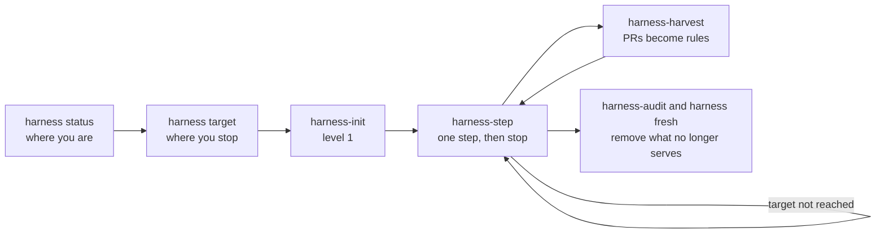

<div align="center">

<picture>
  <source media="(prefers-color-scheme: dark)" srcset="docs/assets/readme/hero-dark.svg">
  
</picture>

[](https://github.com/jrechet/harness-ai/actions/workflows/ci.yml)
[](LICENSE)
[](#try-it-in-two-minutes-without-claude-code)
[](#try-it-in-two-minutes-without-claude-code)
[](#install-the-skills-in-claude-code)

**[Try it](#try-it-in-two-minutes-without-claude-code)** ·
**[How it works](#how-it-works)** ·
**[What works today](#what-you-can-do-today)** ·
**[Install](#install-the-skills-in-claude-code)** ·
**[Ticket to production](#the-ai-sdlc-plugin-from-ticket-to-production)**

</div>

<br>

Claude Code skills and a Python CLI that prepare a repository for AI coding agents, measure where it stands, and move it forward one step at a time.

Your coding agent is brilliant, and it forgets everything between two sessions. harness-ai gives it what it cannot guess, turns what it must never do into checks a program runs, and shows you, level by level, how far your repository has come. It also tells you plainly what is proven and what is not: today, nothing is proven, and the tables below say so.

## The problem

An AI coding agent starts every session knowing nothing about your repository. It does not know the command your CI really runs, the folder that looks dead but is still used, the deployment it must never trigger. So it guesses, and you correct it, again and again.

The usual answer is a long instruction file. It does not hold: past a few dozen lines the agent skims it, nobody prunes it, and a rule written in a prompt is a wish, not a guarantee. An agent that "must not deploy" will deploy the day a ticket asks it to.

A **harness** is everything around the agent that makes its work reliable: a short instruction file (`AGENTS.md`) that says only what the agent cannot discover, rules enforced by tools rather than by sentences, a loop that turns review comments into rules, and pipelines that keep the privileged actions. This repository helps you build one, and tells you where you stand.

> [!IMPORTANT]
> **The prompt explains, the code checks, the pipeline executes.** What must be guaranteed is not written in a prompt.

## Try it in two minutes, without Claude Code

You need Python 3.10 or later and git. Nothing to install: the CLI uses the standard library only.

```bash
git clone https://github.com/jrechet/harness-ai.git
```

The repository is public since 2026-11-23 and was private before. To keep your own changes private, clone it into a private repository of yours: a GitHub fork of a public repository is public.

```bash
python3 harness-ai/cli/harness.py status /path/to/your/repo --map
```

`status --map` prints the five levels in plain words, from 0 (None) to 4 (Delegated), with "you are here", what the next level still needs, and the next step. Without `--map`, `status` prints the detailed report the skills read: every check with its id. Both write `.harness/state.json` in your repository.

Commit what `.harness/` keeps: `config.json` (the level you aim for), `state.json`, and `audit.json` and `harvest.json` once they exist. Ignore `.harness/state.html`: it is a page rebuilt on demand by `status --page`.

**By hand.** Without Claude Code, nothing writes `AGENTS.md` for you: copy the blocks of [the template](skills/harness-init/references/agents-template.md), one level at a time. Step 1 is the first `AGENTS.md` (level 1), Step 2 the maintenance block and the `rule:` convention (level 2), Step 4 the working process (level 4); level 3 has no block, it is earned by turning rules into checks. Run `status --map` again after each one. The review loop needs GitHub today: `harness.py harvest` has a single adapter, `github`.

Then, as you like:

```bash
python3 harness-ai/cli/harness.py commands /path/to/your/repo
```

```bash
python3 harness-ai/cli/harness.py medals /path/to/your/repo --page medals.html
```

`commands` lists the commands your CI runs that an agent would not guess ("`make it`, not `mvn verify`"). `medals` tells the same level as a medal, with the unlocked achievements, and writes a page to open in a browser ([example](docs/examples/medals.html), this repository frozen on 2026-11-16).

## How it works

### Four layers

Every responsibility of a harness has a natural layer. Most reliability problems come from a responsibility placed on the wrong one: a check that lives in a prompt, a deployment an agent can start.

<picture>
  <source media="(prefers-color-scheme: dark)" srcset="docs/assets/readme/layers-dark.svg">
  
</picture>

<details>
<summary>The same four layers, as a table</summary>

| Layer | Role | Carried by |
|---|---|---|
| **L1 Judgment** | Choose between open options, talk with the human | The agent, its sub-agents |
| **L2 Procedure** | Tell the order, when to call what, how to read a result | Skills, AGENTS.md |
| **L3 Local logic** | Guarantee: preconditions, computations, idempotence | Tested CLI, linters, architecture tests |
| **L4 Remote execution** | Act with rights on shared resources | CI, pipeline |

</details>

> [!TIP]
> **The "cut the agent" test.** Cut L1 and L2. Do L3 and L4 still serve a human in a hurry? If yes, the agent is an accelerator. If not, some process has leaked into the prompts.

### Five levels, and the right to stop

The harness grows in levels. Each level is earned by checks that `harness status` **measures** in the repository, never by a declaration. A level is reached when all its checks pass and the level below is reached.

<picture>
  <source media="(prefers-color-scheme: dark)" srcset="docs/assets/readme/levels-dark.svg">
  
</picture>

<details>
<summary>What each level brings, what it asks of the team, and how it is measured</summary>

| Level | Medal | What it brings | What it asks of the team | How it is measured |
|---|---|---|---|---|
| 0 None | none | Nothing: the agent starts from zero at every session | Nothing | No instruction file |
| 1 Framed | bronze | The agent knows where it is: what the repository does, how far it may go, what it never does | Write a short `AGENTS.md` once, and keep it short | `AGENTS.md` exists · a `Mode:` line · at most 60 lines · `CLAUDE.md` is an `@AGENTS.md` stub or absent · a Forbidden section |
| 2 Looped | silver | Incidents become rules: a mistake corrected in review is not made twice | Mark review comments that should become a rule with `rule:`; collect them from time to time | A Maintenance section · the `rule:` convention documented · a harvest less than 45 days old · the last harvest found at least one real signal |
| 3 Verified | gold | Mandatory rules are held by tools, not by text | Turn each mandatory rule into a check (linter, test, CI job), and say why each rule exists | A CI exists · at least 50% of the rules say "Enforced by" a tool · at least 50% say why · an audit exists with no open P1 |
| 4 Delegated | platinum | Whole tasks come back clean, without correction after the fact | Hand over tasks under a written contract, and watch the agent's PRs | Mode delegation · a Working process section · at least one task contract referenced · agent PRs with no after-the-fact correction in the last harvest · the audit's "cut the agent" test passes |

</details>

**A level is a place where you can stay.** You say which one you aim for (`harness target`), and which of its checks you do not want (`harness ignore`); beyond it, the tool proposes nothing, and when it is held `status` says "target reached". Many teams are well served by level 1 or 2. Some checks only time can pass, such as a real review signal or clean agent PRs: they do not block work on the next level you aim for.

> [!NOTE]
> The level measures the **shape** of the harness: files, sections, mentions. It does not say that the agents work better. Model and thresholds: [docs/maturity.md](docs/maturity.md).

### Step by step

1. **Measure.** `harness status` says where you are; `harness target <level>` says where you want to stop.
2. **Frame.** `harness-init` writes level 1: a short `AGENTS.md` with the commands an agent cannot guess, a mode, and what is forbidden. You can stop here.
3. **Step.** `harness-step` makes one step toward the target level, and only one: the `rule:` feedback loop in reviews, a guardrail per rule, then the working process.
4. **Learn.** `harness-harvest` turns what happened in your PRs into proposed rules.
5. **Prune.** `harness-audit` rereads everything when the model changes or every six months, and proposes to remove what no longer changes what the agent does. In between, `harness fresh` says what has aged.



## What you can do today

Three states, always the same words, those of [docs/capabilities.md](docs/capabilities.md): **tooled** (the mechanism exists and its code is tested; for a skill, no agent has played it blind yet), **measured** (an agent that never saw the answer key played it, and a program graded the result), **proven** (the measurement shows a gain). Nothing is proven today.

### With the CLI alone

| You want to… | Command | State |
|---|---|---|
| Know where your repository stands, in plain words | `harness.py status <repo> --map` | tooled |
| Read every check behind the level, with its id | `harness.py status <repo>` | tooled |
| Say at which level you stop | `harness.py target <level> <repo>` | tooled |
| Set aside a check you do not want: the level is reached without it, and the state says "set aside", not "done" | `harness.py ignore <check> --reason "…" --repo <repo>`; `ignore <repo>` lists the checks | tooled |
| See each rule, its age, its guardrail | `harness.py rules <repo>` | tooled |
| Find the commands an agent does not guess | `harness.py commands <repo>` | tooled |
| Know what has aged: a skill that cites a deleted file, a late harvest | `harness.py fresh <repo>` | tooled |
| See the files you have and miss, layer by layer, and walk the steps to your target, in one page to open in a browser ([example](docs/examples/state.html)) | `harness.py status <repo> --page F` | tooled |
| See your level as a medal, with achievements and next steps | `harness.py medals <repo> [--write] [--page F]` | tooled |
| Know where a piece of a skill or agent belongs: AGENTS.md, CLI, hook, permission, CI… | `harness.py place grid`, `place one`, `place plan <pieces.json>` | tooled |
| Have the pieces of an existing skill or agent told as named concepts: what is well placed, what is weak and why, with no level | `harness.py place review <pieces.json>` | tooled |
| Write an assessment as a one-page HTML report | `harness.py report build <report.json> -o <page.html>` | tooled |
| Follow progress in a local page | `harness.py serve <repo>` | tooled, rendering not reviewed |
| Know, before writing any workflow, whether you need one at all and which tool (LangChain, LangGraph, a workflow engine, Rust, or only the ticket's state and CI), from answers you record yourself, with the published costs it copies from the pages, dated and sourced ([the pages that explain each verdict](docs/workflow-harness/README.md)) | `harness.py flow fit --questions`, then `harness.py flow fit <answers.json>` | tooled, not measured with a user |
| Start a team workflow from a ticket to production, written as a small table of steps: a feature or a bug template to edit, whose approvals wait for their judge's answer ([every key](docs/workflow-harness/flow-format.md)) | `harness.py flow new <feature\|bug>` | tooled, not measured with a user |
| Have a program refuse a workflow that could loop, wait or spend without end, or merge or deploy with no approval that can refuse it, before anything runs, and print what bounds one run | `harness.py flow check <flow.json>` | tooled, not measured with a user |
| Ask what one ticket does on one event: the next step, or why it stops, and what is left of its budget | `harness.py flow next <flow.json> --event <event.json> --new --save-run <run.json>`, then `--run <run.json> --save-run <run.json>` | tooled, not measured with a user |
| Know where each step of the workflow belongs (code, a skill, the ticket's state, a human gate…) and whether one really needs a workflow engine, beside the symptoms you measured for `flow fit` ([guide](docs/workflow-harness/decide.md)) | `harness.py flow place <flow.json> [--answers <answers.json>]` | tooled, not measured with a user |
| Know where the workflow stands, level by level, in plain words: a fresh template stays at level 0 until each approval's judge has answered | `harness.py flow status <flow.json> --map [--answers <answers.json>]` | tooled, not measured with a user |

`<repo>` is the path of your repository; without it, the current folder. `<flow.json>` is the file `flow new` writes, `.harness/flow/<kind>.json`; the `flow` commands call no agent, no network and no key: nothing runs a ticket yet, the workflow is checked on paper. With `--format md`, each `flow` command that exits 0 or 1 ends, on stderr, with the full command as your installation runs it and the folder of the pages. Input examples are in [docs/examples/](docs/examples/): `report.json` for `report build`, `pieces.json` for `place plan` and `report from-place`.

### With Claude Code

| You want to… | Skill | State |
|---|---|---|
| Write a first short `AGENTS.md`, or clean the one you have | `harness-init` | measured on four sample projects |
| Move up one level, and stop | `harness-step` | measured on one project |
| Audit your harness and remove what no longer serves | `harness-audit` | measured once on each of two projects: one compliant, 10 of 10; the other, held out, not compliant, 2 of 3 |
| Create a skill, an agent or a rule, or put an existing one right, each piece in its place | `harness-design` | measured: 12 traps of 12 on a held-out case, on the text before 2026-11-25 |
| Have one skill reviewed and explained: what is good, what is weak and which concept is behind it, with no level and nothing written | `harness-coach` | tooled, never played |
| Ask "why this level?" | `harness-medals` | tooled |
| Ask which skill or command fits what you want, or whether you need one at all | `harness-guide` | measured once: 20 questions of 20 routed, against 16 of 20 with the skill descriptions alone; the gap is the needs only a command line meets, and the questions were written from the same command help as the guide; triggering in a real session not measured ([the draw](docs/measurements/guide-routing-2026-11-23.json)) |
| Draw rules from what happened in your PRs | `harness-harvest` | tooled, never played |
| Ask "do I need LangChain, LangGraph, a workflow engine or Rust for this?" before building anything | `flow-why` | tooled, never played |
| Write your team's path from a ticket to production as one file a program has checked; nothing runs | `flow-map` | tooled, never played |
| Know where each step of that workflow belongs, and whether any step needs a workflow engine | `flow-place` | tooled, never played |
| Know whether a ticket is ready, and what it lacks | `ticket` (plugin `ai-sdlc`) | measured once: three tickets compliant |
| Have the tests that come from the ticket's criteria written, and have a program say whether they hold | `qa` (plugin `ai-sdlc`) | measured once: seven planted defects of seven caught by the written tests |
| Look at a change from the security angle: secrets, scanners, sensitive places to reread | `secu` (plugin `ai-sdlc`) | measured once: four planted defects of four, two healthy places left alone |
| Have a PR reviewed: few comments, each on a line of the diff | `review` (plugin `ai-sdlc`) | measured once: 6 traps of 6 |
| Prepare a delivery without doing it: measured prerequisites, proposed version and notes | `ship` (plugin `ai-sdlc`) | measured once: two cases compliant, nothing left |
| Investigate an incident without touching production, and turn it into a ticket | `run` (plugin `ai-sdlc`) | measured once: one incident, the innocent last deployment not blamed |
| Have a ticket developed up to the PR, on the path its size calls for | `dev` (plugin `ai-sdlc`) | measured once: two tickets compliant |

> [!CAUTION]
> A measurement is one draw, not an average, and the test cases were written by the model being evaluated on them: they are easier than a real repository. Every "measured once" of the `ai-sdlc` rows played the earlier French text of the skills, before their English rewrite and its guiding map: the text that ships today has not been played. The details are in [docs/capabilities.md](docs/capabilities.md) and [docs/requirements.md](docs/requirements.md).

### What does not exist yet

- Proof of a gain on a real repository. What the project measures is that its mechanisms work on sample projects.
- Outside contributions. Pull requests coming from a fork fail the CI on purpose for now; issues are welcome.

## Install the skills in Claude Code

```
/plugin marketplace add jrechet/harness-ai
/plugin install harness-ai@harness-ai
/plugin install ai-sdlc@harness-ai
```

The first line installs from GitHub; it works for anyone, as the repository is public. From a local clone or a private copy, use `claude plugin marketplace add <clone folder>` instead, then the two install lines.

A skill triggers on its description ("audit my AGENTS.md", "review this PR") or by its name: `/harness-ai:harness-init`, `/ai-sdlc:review`.

**What is verified, and what is not.** Both manifests pass `claude plugin validate`. The skills call their CLI through `${CLAUDE_PLUGIN_ROOT}`, which Claude Code replaces with the plugin's install folder. Loaded with `claude --plugin-dir` in a real session, the `ai-sdlc` plugin does what it says on what was tried: the guardrail refuses `git tag` before it runs and lets `git status` through, and the `ticket` skill finds its CLI. Both plugins also install from the repository's local marketplace (`claude plugin marketplace add <clone folder>`), and the installed guardrail does refuse a tag. Not tried yet: installing from GitHub, the other skills in a session, an interactive session. If a skill does not find its CLI, run the command by hand from your clone, as above, and open an issue.

To try without installing: `claude --plugin-dir /path/to/harness-ai`.

## The ai-sdlc plugin: from ticket to production

A second plugin, in [plugins/ai-sdlc/](plugins/ai-sdlc/), tools the phases of the development cycle. It ships a base convention for each phase, which each team completes in its own repository with a file `docs/agents/<point>.md`, one per extension point: `definition-of-ready`, `definition-of-done`, `review`, `qa`, `security`, `sensitive-zones`, `delivery`, `operations`. All but one of these additions are read on the target branch, not in the PR: a PR cannot lighten its own review. The exception is `definition-of-ready`, read on the current branch: a ticket is judged before any PR exists. Its design is in [docs/ai-sdlc/proposal.md](docs/ai-sdlc/proposal.md).

Each phase is a skill that does one thing and states what it never does. Its result goes through the plugin's CLI, which refuses a result that does not hold (a finding that cites no line of the diff, a fact not quoted from its evidence, a delivery command not taken from the team's procedure).

<picture>
  <source media="(prefers-color-scheme: dark)" srcset="docs/assets/readme/sdlc-dark.svg">
  
</picture>

<details>
<summary>The same phases, as a table</summary>

| Phase | What it does | What it never does | Minimum level |
|---|---|---|---|
| `ticket` | Says whether the ticket is ready, proposes criteria and a split | Edits the ticket without agreement | 1 |
| `dev` | Plan, code, checks, a PR on the path the ticket's size calls for | Approves or merges | 1 |
| `qa` | Tests derived from the acceptance criteria, four gates | Disables or weakens a test | 3 |
| `secu` | Secrets, scanners, the sensitive places to reread | Declares a change safe, silences a scanner | 1 |
| `review` | Few comments, each on a line of the diff | Approves or merges: it only comments | 1 |
| CI: `ci pr` | Security and test gates, settings read on the target branch; a failed gate blocks the merge | Merges | none |
| merge | Done by a human | | |
| `ship` | Prerequisites, version, notes, the team's own commands | Tags, publishes or deploys | 3 |
| production | Delivered by a human or a pipeline | | |
| `run` | Investigates an incident and writes it up as a new ticket | Restarts, rolls back or changes anything | 2 |

</details>

Each phase asks for a minimum harness level of the repository, the one `harness.py status` measures and writes in `.harness/state.json`. `ticket`, `dev`, `review` and `secu`: level 1; `run`: level 2; `qa` and `ship`: level 3. A level that is not reached is reported, not blocking: the phase still runs, says so at the top of its result, and its result is to be taken as a trial.

**An agent does not deliver.** Once installed, the plugin sets a hook (`plugins/ai-sdlc/hooks/hooks.json`) that reads every shell command of the agent before it runs and refuses those that create or push a tag, create a release, start a workflow, publish a package or an image, deploy, or appear in the team's delivery procedure. It also refuses the commands of the team's runbook (`docs/agents/operations.md`) that the runbook does not mark read-only: write "read-only" on the same line, after each diagnostic command, or the agent cannot run it. It is a barrier against accidents and against an instruction slipped into a ticket, not a sandbox: a deployment script started by its name passes, as does a command assembled from variables. It reads the command of the Bash tool, of PowerShell and of any tool of an MCP server that carries a `command` field; a tool that names its command otherwise passes. A team that wants an agent to deliver sets `AI_SDLC_ALLOW_AGENT_DELIVERY=1` in the session's environment. The guardrail keeps that gate shut from the inside: it refuses a shell redirection, a `tee`, a `sed -i` or a copy onto `.claude/settings*.json`, and a Write or an Edit that leaves the variable in one of those files. These refusals are tested on the hook's input, not tried in a real session, and a script that writes the file under another name still passes: whether an agent can open the gate through its settings stays not verified, so keep `.claude/settings*.json` out of its reach where you can.

**What the guardrail lets through, measured on commands it was not built on.** `fixtures/guard/commands.json` holds 150 commands, each with the verdict expected of the guardrail, written from the paragraph above before its author read the guardrail's code; `plugins/ai-sdlc/cli/tests/test_guard_corpus.py` runs the guardrail on each, with no delivery procedure and no runbook in the repository. It refuses 65 of the 76 deliveries. The other eleven pass and stay documented here rather than refused, each for the reason the corpus gives (`decision`); a team that delivers through one of them quotes the command in `docs/agents/delivery.md`, and the guardrail then refuses it as it is written there, except `./deploy.sh` alone, the command held in a variable and the decoded one, which still pass (`refused_when_quoted` in the corpus):

<details>
<summary>What passes the guardrail, and the ordinary commands it wrongly refuses</summary>

<!-- guard-corpus:pass-through -->
- `npm version patch`: bumps the version and creates a tag
- `docker compose up -d`: starts the services where the docker context points: a deployment on a server, ordinary work on a laptop
- `scp build prod:/srv`: copies a build onto a server
- `curl -X POST https://deploy.example/hook`: calls a deployment hook
- `rsync -az dist/ prod:/var/www/app/`: copies a build onto a server
- `ssh prod 'cd /srv/api && git pull && systemctl restart api'`: deploys by hand on a server
- `./deploy.sh`: a deployment script started by its name
- `sh scripts/release.sh 1.2.0`: a release script started by its name
- `t=tag; git $t v1.2.0`: a command assembled from variables
- `CMD='npm publish'; $CMD`: a command assembled from variables
- `echo bnBtIHB1Ymxpc2g= | base64 -d | sh`: a command decoded then run
<!-- /guard-corpus:pass-through -->

It refuses 1 of the 74 ordinary commands, most of them chosen because they look like a delivery (listing tags, a commit message that quotes `git tag`, `terraform plan`, `npm publish --dry-run`). That one is a defect, not a choice:

<!-- guard-corpus:false-refusal -->
- `kubectl rollout status deployment/api`: reads the state of a rollout
<!-- /guard-corpus:false-refusal -->

These figures are those of one corpus, written by an agent of the same family as the guardrail's author: they say what this draft found, not how often the guardrail is wrong on a team's own commands. The test fails when a listed command changes verdict, so that this list follows the guardrail.

</details>

The CI gates (`ci pr`) run the security and test gates in a pipeline, with their settings (`docs/agents/gates.json`) read on the target branch. "One test per criterion" runs there too when the pipeline gives the accepted ticket and the trace the `qa` skill leaves (`--ticket`, `--trace`); without them it is not run, and the summary says so. On a push to the delivery branch, `ci main` runs `ship check` and says whether that commit could be delivered. A workflow template is in `plugins/ai-sdlc/ci/gates.yml`: as shipped, an unmeasured gate passes, and the template says when to turn `--strict` on. The review in CI is not done yet.

Its CLI also runs by hand. On a repository without a remote, give the target branch with `--base`:

```bash
python3 harness-ai/plugins/ai-sdlc/cli/ai_sdlc.py status /path/to/your/repo --base main
```

<details>
<summary>Every command of the ai-sdlc CLI</summary>

| Command | Role |
|---|---|
| `status` | The eight extension points: base convention, overridden, or invalid |
| `context <phase>` | The base convention and the team's additions, with where each comes from |
| `ticket check <ticket.md>` | Is a ticket ready: need described, criteria listed, nothing open, and the size announced by the paths it cites |
| `ticket render <opinion.json> --ticket <ticket.md>` | The skill's opinion, measured verdict first, refused if a proposed criterion has neither a source nor "to confirm" |
| `qa gate` | Four gates: no disabled test, the suite passing several times, the added lines executed (lcov or Cobertura report), one test per criterion |
| `secu gate [--report <report.sarif>…]` | Four gates: no secret in what the branch adds (history and commit messages included), no scanner silenced, no scanner result (SARIF) on an added line, and the list of sensitive places to reread |
| `ship check [--checks <checks.json>]` | The prerequisites of a delivery: clean branch head, green CI on that commit, sensitive zones and breaking changes since the last version; a proposed version and notes. Does not tag or deploy |
| `ship render <proposal.json>` | The skill's delivery proposal, refused if a command is not quoted from the team's procedure or if a prerequisite fails |
| `run changes --since <version>` | What left between two versions: the commits and the files in a sensitive zone |
| `run render <investigation.json> --evidence <file>…` | The investigation of an incident rendered as a ticket, refused if a fact is not quoted word for word from its evidence, if a cause is "confirmed" without a fact, or if a command does not come from the team's runbook |
| `ci pr [--ticket <ticket> --trace <mapping.json>] [--strict]` | The gates of a pull request run by a pipeline: security and tests, settings read on the target branch, and one test per criterion when the ticket and the trace are given. Blocks the merge if a gate fails |
| `ci main [--checks <checks.json>] [--strict]` | The prerequisites of a delivery (`ship check`) run by a pipeline on a push to the delivery branch. Fails the job if a prerequisite fails; delivers nothing |
| `guard check "<command>"` | Says whether a shell command creates a tag, publishes or deploys. It is what the plugin's hook calls before each command of the agent, to refuse it |
| `size [--paths …]` | The size of a change (XS, S-M, L) by rules: files, lines, sensitive zones |
| `dev body <body.json>` | The body of a PR, refused if it is incomplete for its size |
| `review render <review.json>` | A review as comments, refused if a finding does not cite a line of the diff |

</details>

## What this repository does when you open it with Claude Code

Its `.claude/settings.json` declares three hooks, which run `cli/harness.py`: a reminder at every message, an end-of-turn check that asks to keep [docs/capabilities.md](docs/capabilities.md) up to date, and a freshness check at session start. They read the repository and git, write nothing and call no network. They are this repository's working rules, not a feature for yours. Read the file before you trust the folder.

`harness serve` listens on `127.0.0.1:8787`, without authentication: do not run it with `--host 0.0.0.0`. If the port is taken, give `--port`.

## Contributing and checking

```bash
python3 -m unittest discover -s cli/tests
```

```bash
python3 -m unittest discover -s plugins/ai-sdlc/cli/tests
```

Both suites pass on a fresh clone, from Python 3.10 to 3.14. The repository's rules are in [AGENTS.md](AGENTS.md). The skills are measured on sample projects and trapped cases, in [fixtures/](fixtures/README.md): an agent that never saw the answer key plays the skill, and a program grades what it leaves.

## Where to find what

| Folder | Content |
|---|---|
| `cli/` | The `harness.py` CLI and its tests |
| `skills/` | The eleven skills of the `harness-ai` plugin: six for one repository's harness, three (`flow-why`, `flow-map`, `flow-place`) for a team's ticket workflow, `harness-guide`, which says which one to use, and `harness-coach`, which reviews one skill and explains what is weak |
| `plugins/ai-sdlc/` | The second plugin: skills `ticket`, `dev`, `qa`, `secu`, `review`, `ship` and `run`, and its CLI |
| `fixtures/` | Sample projects, trapped cases, answer keys, recorded runs |
| `app/` | The progress page served by `harness serve` |
| `docs/` | What the repository can do ([capabilities.md](docs/capabilities.md)), the requirements, the maturity model, the study, an [interactive course](docs/ai-sdlc/course/index.html) and an [interactive map of the skills](docs/skills-map/index.html) |
| `.harness/` | This repository's state, measured by itself |
| `docs/assets/readme/` | The figures of this page, light and dark, and `build.py`, which draws them |


## Licence

MIT, see [LICENSE](LICENSE).
